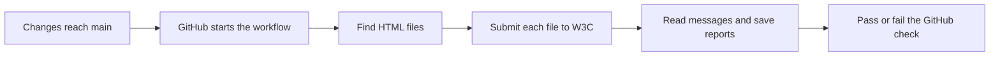

# W3C markup validation

This check automatically asks W3C whether each HTML page follows HTML markup rules. For example, it can report an image missing its `alt` attribute or an element placed somewhere it is not allowed. You do not have to paste every file into the validator by hand.

## What happens after a merge

1. A pull request is merged into `main`, or someone commits directly to `main`.
2. GitHub starts a temporary Linux computer called a **runner**.
3. The runner downloads that commit's files and installs Node.js, which runs JavaScript outside a browser.
4. Our script finds the HTML files and sends them to W3C one at a time.
5. W3C replies with a list of messages. The script counts errors and warnings for each file.
6. GitHub shows a green check if every file passes, or a red check if any file fails or cannot be checked. Reports are saved either way when available.



This runs **after** the merge. It does not block merging, undo a merge, or control GitHub Pages deployment. It also does not automatically refresh an open browser tab.

## Which files do what?

| File | Purpose |
| --- | --- |
| `.github/workflows/validate-html.yml` | Tells GitHub when to run and which steps to perform. |
| `scripts/validate-html.mjs` | Finds HTML, asks W3C to check it, and saves the results. `.mjs` is a JavaScript module file. |
| `.gitignore` | Keeps generated validation reports out of Git history. |
| `VALIDATION.md` | Explains how to use and understand the check. |

The workflow and script have comments before each code line. YAML comments begin with `#`; JavaScript comments begin with `//`. Comments explain the next line and are not executed.

## Reading the script

Read the file from top to bottom. The first section imports tools already included with Node.js. Next come helper functions, which only run when called. The main checking process starts at `const files = ...` after those functions.

| Function or section | Plain-language explanation |
| --- | --- |
| `findHtml(directory)` | Opens a folder and looks for `.html` and `.htm` files. It calls itself for subfolders, so new pages are included automatically. |
| `escapeAnnotation(value)` | Encodes special characters so a message cannot accidentally change GitHub's log-command format. |
| `annotate(...)` | Tells GitHub which filename and line to highlight. Local runs still show ordinary text messages. |
| `parseResult(output)` | Reads W3C's JSON response and checks that it contains the expected message structure. JSON is a text format for storing data. |
| `validate(filename)` | Reads one file, uses `curl` to send it to W3C, and returns the response. curl is a command-line web-request tool. |
| The main `for` loop | Checks every file, counts messages, and keeps going if an earlier file fails. |
| The final section | Saves detailed JSON and a readable Markdown summary, then returns success or failure to GitHub. |

`await` means “wait for this operation to finish.” `try`/`catch` lets the script record a problem with one file and continue checking other files. The `failed` variable remembers any failure so that a later valid page cannot turn the whole run green.

There are two different kinds of success to check: the web request must succeed, and W3C must report no markup errors. A successful HTTP response can still contain HTML errors. This script checks both.

## Running it yourself

Run `node scripts/validate-html.mjs` from the repository root with Node.js 24 and curl installed. No npm packages are needed. To check selected files, append their paths to that command.

```sh
# Check every HTML file.
node scripts/validate-html.mjs

# Check just one page while working on it.
node scripts/validate-html.mjs index.html
```

The script runs on your computer or the GitHub runner, not inside the website. Your published pages remain plain HTML and CSS.

The workflow in `.github/workflows/validate-html.yml` runs whenever changes are pushed to `main`, including merged pull requests and direct commits. It can also be run manually from Actions → W3C HTML validation → Run workflow once installed on the default branch. It discovers all `.html` and `.htm` files recursively, including new pages. It excludes Git metadata, installed Node dependencies, and generated validation reports. CSS, JavaScript, and Markdown are not HTML documents and are not submitted to the markup validator.

Each source file is submitted directly to `https://validator.w3.org/nu/?out=json`, the automation endpoint recommended by https://validator.w3.org/docs/api.html for modern HTML. This checks the triggering commit without waiting for GitHub Pages deployment. Source files leave the runner and are sent to W3C's public service.

Errors fail the check. Warnings are displayed but do not fail it, following W3C's validity result. Unavailable service, timeouts, malformed responses, and incomplete validation fail the check rather than giving a false pass. Requests are sequential, with a pause between files and bounded retries for temporary HTTP failures. Rerun the workflow if the external service is unavailable.

## Understanding results

| Status | Meaning | What to do |
| --- | --- | --- |
| `PASS` | W3C found no markup errors. There may still be advisory warnings. | Read any warnings and decide whether to improve the page. |
| `FAIL` | W3C found markup errors. | Open the named HTML file at the reported line, fix the problem, and run the check again. |
| `INCOMPLETE` | The file could not be fully checked, such as when W3C is unavailable. | Read the request error; rerun for a temporary service problem. Do not assume the HTML itself is invalid. |

For example, `` will normally produce an error because it is missing `alt`. A meaningful image could be written as ``. The correct text depends on the image's purpose; purely decorative images can use `alt=""`.

To see the results, open **Actions → W3C HTML validation**, then select a run. The summary lists every file. Open the **Validate all HTML with W3C** job for detailed messages. The **Artifacts** section contains the `w3c-validation-results` download with `results.json` and `summary.md`.

Results appear in the Actions log, file annotations, job summary, and downloadable `w3c-validation-results` artifact. Local results are saved in `.validation-results/`. A failing check does not itself prevent merging or GitHub Pages deployment; repository rules or a deployment dependency must be configured separately if that is desired.

The long hexadecimal values after `uses:` in the workflow select exact versions of GitHub's helper actions. `contents: read` means the workflow can read the repository but cannot push changes. `if: always()` attempts to save reports even after a validation failure. Reports are kept for 14 days. If another run starts for the same branch, the older running check is canceled to avoid redundant requests.

## Scope and limitations

This is a markup check. It does not prove the layout looks right, links work, spelling is correct, JavaScript behaves correctly, or all accessibility needs are met. CSS has a separate W3C validator and is not submitted by this workflow.

All four current HTML files are complete documents with their headers inline. If JavaScript-loaded fragments are introduced, add validation of assembled documents; the W3C service does not execute JavaScript or check dynamically inserted markup automatically.

For manual Validate by URI checks at https://validator.w3.org/, enter the published page URL, for example `https://zoeyhayes-cloud.github.io/CIS124_CourseProject/index.html`. A `github.com/.../blob/...` URL is GitHub's file viewer, not the webpage. URI checks can be affected by deployment delays and service access restrictions.

## Optional practice: make an error, read it, and fix it

You can try this locally before relying on the automatic check. Keep this exercise out of `main` so it does not deliberately break the published project.

1. Make a temporary copy of `index.html` called `practice.html` in your local project folder.
2. Inside its `<main>` element, add ``.
3. Run `node scripts/validate-html.mjs practice.html`. W3C should report that the image needs an `alt` attribute. Read the filename and line number in the output.
4. Change the element to ``, using an accurate description if you use a real image.
5. Run the same command again. The missing-attribute error should be gone. This checks the HTML markup; it does not confirm that `cat.png` exists or that the description is accurate.
6. Delete `practice.html` when finished, then run `node scripts/validate-html.mjs` to check the real project pages.

The goal is to see the cycle: **write HTML → read the validator's feedback → understand the rule → fix the HTML → check again**. If you get `INCOMPLETE`, investigate the service or request error before changing your HTML.

### Questions to discuss during review

- Which workflow lines make the check run after a merge to `main`?
- Why does the script check the contents of W3C's response even after the web request succeeds?
- Why must one passing page not erase another page's failure?
- What is the difference between a markup error and a service outage?
- Can valid HTML still contain a broken link or have an unreadable layout?

## Checks performed for this change

The four existing pages passed a live W3C check with zero errors and zero warnings. A separate deliberately invalid page failed on a missing `alt` attribute, confirming that markup errors produce a failing exit status.

Local command-line checks also exercised valid responses, invalid markup, warnings, incomplete service responses, malformed responses, HTTP failures, an empty folder, and a nested HTML filename containing a space. The workflow YAML was parsed to verify its triggers and command. A hosted Actions run still needs to be observed after the owner accepts this workflow into `main`.

References: [W3C API documentation](https://validator.w3.org/docs/api.html), [W3C JSON result format](https://github.com/validator/validator/wiki/Output-%C2%BB-JSON), and [GitHub workflow triggers](https://docs.github.com/en/actions/how-tos/write-workflows/choose-when-workflows-run/trigger-a-workflow).
